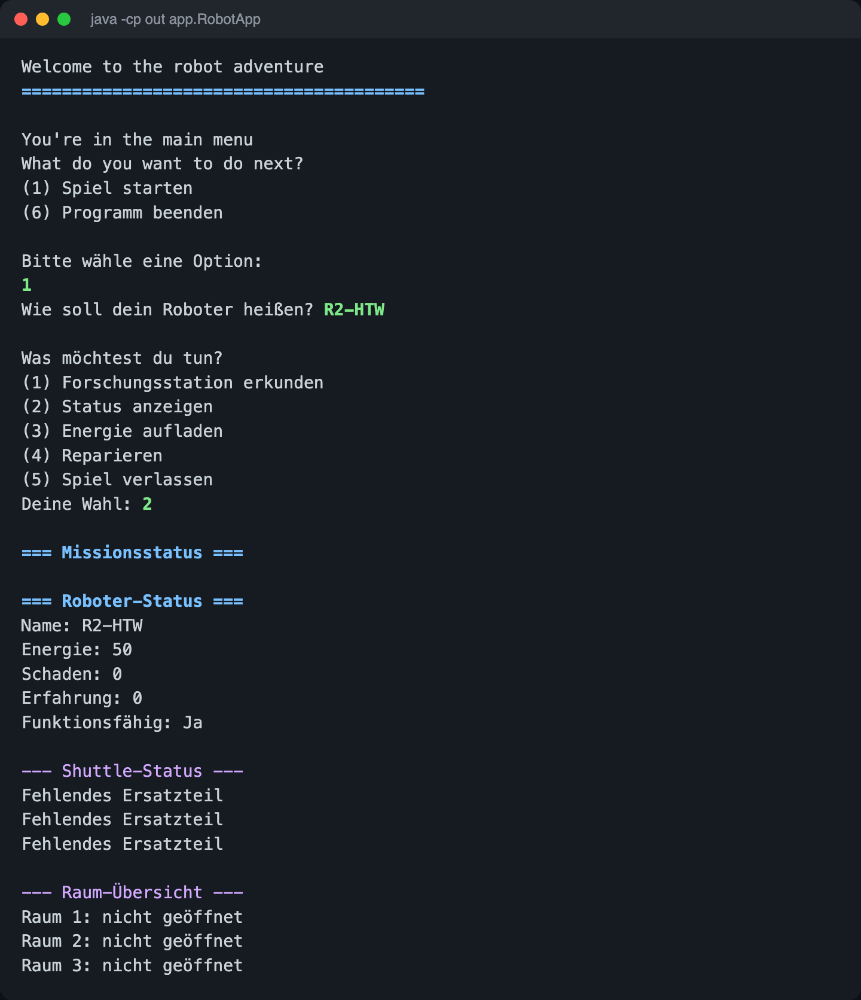

# Robot Rescue

A text adventure in Java, written for the object-oriented programming course at **HTW Berlin**
(summer semester 2025, GitHub Classroom assignment). You steer a robot through a research station, crack
code puzzles, deal with enemies and mini-games, and collect the parts needed to launch a shuttle before
the robot runs out of energy.



## Run it

Requires a JDK (17 or newer). No build tool needed:

```bash
javac -d out $(find . -name "*.java")
java -cp out app.RobotApp
```

## What's inside

- **Exploration:** rooms open in random order; each room guards a shuttle part behind a code puzzle, and enemies can turn up on the way.
- **Puzzles:** binary code, Morse code and a Caesar cipher.
- **Enemies and mini-games:** fight, flee, or win a round of Tic-Tac-Toe or Nim instead.
- **Robot state:** energy, damage and experience; recharge and repair between rounds.
- **Save and load:** the whole game state is written to a file with Java serialization.

## Design

About 1,900 lines of Java in five packages:

```text
app/         entry point, menus and the game loop
challenges/  Challenge interface + BinaryCode, MorseCode, SecretCode
games/       Game interface + TicTacToe, Nim
model/       Robot, Room, Artifact, Shuttle, abstract Enemy + AlienEnemy, DroneEnemy
utils/       StopWatch
```

- **Interfaces as extension points (strategy style):** the game loop only knows `Challenge` and `Game`.
  A new puzzle or mini-game is a new class, with no change to the loop.
- **Inheritance where behaviour differs:** `Enemy` is abstract; `AlienEnemy` and `DroneEnemy` decide how they attack.
- **Serializable model:** `RobotGame`, `Robot`, `Room`, `Shuttle` and `Artifact` implement `Serializable`, so
  saving is a single `ObjectOutputStream` write.

## License

[Apache 2.0](LICENSE)
